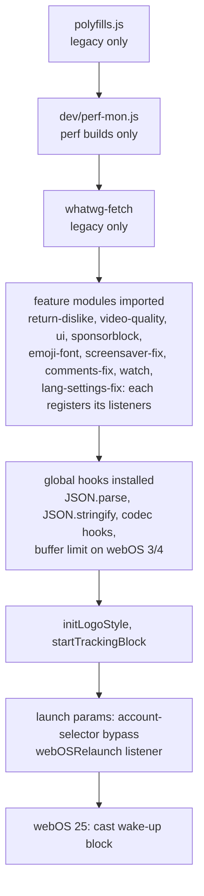
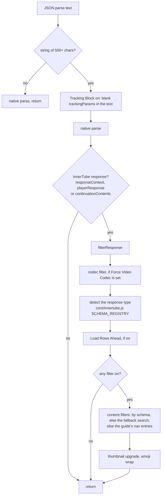

# Architecture

How YouTube AdFree for webOS is put together: what runs where, in what order,
and how the parts talk to each other. Written for people and for AI agents
opening the project for the first time.

- **This file** is the overview, kept by hand.
- **[CODEMAP.md](CODEMAP.md)** is the generated map: every module and every
  named function, what it does, what it calls and what calls it, and which
  settings, events, YouTube selectors and browser hooks it touches. One page
  per folder in [codemap/](codemap/), the same data as JSON in
  [codemap.json](codemap.json). `npm run codemap` rebuilds it; `npm test`
  fails while it is out of date.
- **[DEPENDENCIES.md](DEPENDENCIES.md)** covers the npm packages, how to update
  them safely, and the security status.

## Two scripts, two builds

The app is a webOS web app with two scripts (`webpack.config.js`):

| Script | Runs in | Does |
| --- | --- | --- |
| `src/index.js` | the app's start page (`index.html`) | Sends the app to `https://www.youtube.com/tv` with the launch parameters (a deep link, a voice search), then is gone. |
| `src/userScript.js` | YouTube's TV site, injected by webOS (`webOSUserScripts/userScript.js`) | Everything else: the hooks, the features, the settings panel. |

Each release is built twice from the same source:

| Build | Command | For | Engine |
| --- | --- | --- | --- |
| legacy | `npm run build` | webOS 3 to 6 | Chromium 38 to 79, compiled to ES5 |
| webOS 22+ | `npm run build:modern` | webOS 22, 23, 24, 25 | Chromium 87 or newer |

`resolve.alias` in `webpack.config.js` leaves out what a build does not need.
A module imported by name gets a stand-in with the same exports
(`*-absent.js`); one imported for its side effects maps to nothing:

| Module | legacy | webOS 22+ |
| --- | --- | --- |
| `polyfills/polyfills.js`, `whatwg-fetch` | in | out (Chrome 87 has it all) |
| `features/emoji-font/`, `features/adblock/emoji-wrap.js` | in | out / `emoji-wrap-absent.js` (the emoji fix is webOS 3/4 only) |
| `hooks/buffer-limit.js` | in | out (the memory problem is webOS 3/4 only) |
| `features/block-webos-cast.ts` | `block-webos-cast-absent.js` | in (webOS 25) |
| `features/video-quality/kickstart.js` | `kickstart-absent.js` | in (webOS 25) |
| `dev/perf-mon.js` | out unless `--env perf` | out unless `--env perf` |

`babel.config.js` has one branch per build (`envName` legacy or modern). There
is no core-js: the legacy polyfills are hand-written in `src/polyfills/`, one
group per file, each feature-detected (the reason is in DEPENDENCIES.md).

## Folders

| Folder | What lives there |
| --- | --- |
| `src/core/` | Shared building blocks: settings (`config.js`, `config-options.js`), page state, the remote's keys, the webOS version, logging, DOM helpers, the YouTube selectors table, the InnerTube response shapes. No feature logic. |
| `src/hooks/` | Wrappers around browser built-ins that more than one feature uses: `fetch` (`fetch.ts`), YouTube's `resolveCommand` (`resolve-command.ts`), and the MSE buffer cap (`buffer-limit.js`). |
| `src/features/` | One folder (or file) per feature. A feature reads its settings, listens to page events and touches YouTube's page or responses. |
| `src/ui/` | The options panel (`panel/`), the remote shortcuts (`shortcuts/`), the toasts (`toast/`), the theme classes on `<html>` (`styles/`). |
| `src/polyfills/` | What Chromium 38 lacks and the code uses (legacy build only). |
| `src/dev/` | The perf monitor, a development tool (`npm run build:perf`). |
| `tools/` | Build helpers (the CSS collector, the bare-require check), the code map generator, the bundle snapshot. |
| `tests/` | `run-all.mjs` runs everything: unit tests, behaviour tests on simulated webOS pages (jsdom, with a Chromium 38 profile for the legacy build), smoke tests on the built bundles, benchmarks. |

## Start-up order

`src/userScript.js` decides the order. Its imports run top to bottom, and each
feature module registers its listeners while it is imported:

1. **Polyfills** first: `whatwg-fetch` checks at load whether `URLSearchParams`
   exists.
2. **perf-mon** (perf builds only) before everything else, so its probes sit
   underneath every other hook.
3. **The feature modules.** Importing one registers its page and setting
   listeners; the order of these imports is the order those listeners run in.
4. **The global hooks**, once every module has loaded (the codec filter runs
   inside the parse hook, so it must exist first).
5. **Launch handling**: the account-selector bypass for a launch with
   parameters, and the `webOSRelaunch` listener (the app was opened again while
   running, for example from a voice search).

`src/ui/index.js` (imported among the features) makes sure a key opens the
settings, sets the `<html>` theme classes and greets the user with a toast.

## The hooks

The app changes YouTube's behaviour mostly by standing between YouTube's code
and the browser:

| Hook | Installed by | Used for |
| --- | --- | --- |
| `JSON.parse` | `features/adblock/parse-hook.js` | Every InnerTube response YouTube parses: ad removal, the Shorts/Live/shelf filters, endcards, Load Rows Ahead, the codec filter, thumbnail upgrades, the emoji wrap. |
| `JSON.stringify` | `features/adblock/stringify-hook.ts` | Outgoing player requests: marks them `isInlinePlaybackNoAd` while Ad Blocking is on. |
| `window.fetch` | `hooks/fetch.ts` (`FetchRegistry`) | Listeners can see and cancel requests: Tracking Block cancels telemetry. Without listeners the original fetch is called directly. |
| `window.fetch` (second wrapper) | `features/block-webos-cast.ts` | webOS 25: fails the request that wakes the cast receiver. A plain string check, not a registry listener, so other requests stay on the fast path. |
| `XMLHttpRequest.prototype.open/send` | `features/adblock/tracking-block.js` | Tracking Block: telemetry XHRs go to an empty `data:` URL. |
| `resolveCommand` on YouTube's app object | `hooks/resolve-command.ts` | `features/lang-settings-fix.ts`: a language change in YouTube's settings is written to the `PREF` cookie and the page reloads, which the TV app does not do by itself. |
| `MediaSource.isTypeSupported`, `HTMLMediaElement.prototype.canPlayType` | `features/force-codec/hooks.js` | Force Video Codec: declines the codecs the setting rules out. |
| `MediaSource.prototype.addSourceBuffer`, `SourceBuffer.prototype.appendBuffer`, `URL.createObjectURL` | `hooks/buffer-limit.js` | webOS 3/4: trims already-played video from the buffers so the TV does not run out of memory. |

The table of every hook with the function that installs it is in
[CODEMAP.md](CODEMAP.md#hooks-and-diagnostics).

### How a response goes through the parse hook

`hookedParse` sees every `JSON.parse` call YouTube makes, thousands of them, so
it is built to cost nothing for the ones that do not matter:

The switches it reads are one snapshot (`features/adblock/flags.js`),
recomputed when a setting changes rather than read on every parse.

## Pages, videos and the player

- **Page state** (`core/page-state.js`) watches the `<body>` classes YouTube
  sets (`WEB_PAGE_TYPE_WATCH` and so on) and dispatches `ytaf-page-update` when
  the kind of page changes. `isWatchPage()`, `isShortsPage()` and
  `isSearchPage()` read the same state.
- **Per-video instances** (`core/per-video.js`): SponsorBlock and Return
  YouTube Dislike get one instance per watched video, created when the watch
  page shows a video, kept across hash changes of the same video, destroyed
  when the video changes, off the watch page, on unload, and recreated when
  their setting changes. The live instance is reachable through
  `getSponsorBlock()` / `getReturnDislike()` and, for the TV's web inspector,
  `window.sponsorblock` / `window.returnYouTubeDislike`.
- **Player state**: `features/video-quality` attaches to YouTube's player on
  the watch page and re-publishes its state changes as `yt-player-state-change`;
  the clock and SponsorBlock follow it. `core/player-state.js` names the states.
- **Synthetic keys** (`core/remote.js` `sendKey`): some features press remote
  keys on the user's behalf (the account-selector bypass, the Shorts
  keep-alive, the chapter skip). Those events carry `SYNTHETIC_KEY_FLAG`, so
  the shortcut router and the panel ignore them.

## Settings

- `core/config-options.js` declares every setting: key, default, label. The
  [settings table](CODEMAP.md#settings) lists each one with the code that
  reads, writes or listens to it.
- `core/config.js` keeps them in memory (one localStorage entry,
  `ytaf-configuration`, read once and written back debounced).
  `configRead(key)` and `configWrite(key, value)` throw for a key that does not
  exist; `configAddChangeListener(key, fn)` is how a feature follows a setting.
- Hot paths do not call `configRead`: the ad block keeps a snapshot
  (`flags.js`), and the looks are classes on `<html>`
  (`ui/styles/html-classes.js`: `ytaf-theme-red`, `ytaf-oled`,
  `ytaf-remove-borders` for Liquid Glass, `ytaf-fix-titles`) that the
  stylesheets select on, so a change of setting is one class toggle.
- A setting from an older build that this one does not have is dropped on the
  next write (`buildConfig`).

## The settings UI and shortcuts

- **Panel** (`ui/panel/`): built the first time it opens. Only the Main page is
  built then; the others are built one per animation frame afterwards. It has
  its own arrow-key navigation (`keyboard.js`), a focus trap (`focus-trap.js`),
  and controls bound to settings (`controls/`).
- **Shortcuts** (`ui/shortcuts/`): `router.js` listens to `keydown` in the
  capture phase, before YouTube, and runs the action bound to the key
  (`actions.js`); the bindings are settings (`shortcut_key_*`).
- **Toasts** (`ui/toast/`): `showNotification(text, time, slot)`. A repeated
  text extends its toast; a slot (play/pause, the seek total) keeps one toast
  that changes in place.

## YouTube's markup

Every class name, id and tag of YouTube's page the code depends on is in one
table, `core/selectors.js` (`SELECTORS`). When YouTube changes its markup, the
fix goes there; [the selectors table](CODEMAP.md#youtube-selectors) shows which
functions use each entry. YouTube's six-letter class names are obfuscated and
change the most.

YouTube's TV app renders with its own virtual DOM and removes nodes it did not
create from its elements, so the app's own elements (the clock, the panel, the
toasts, the SponsorBlock overlay) live in `<body>` or are re-added when YouTube
re-renders.

## Diagnostics

- **Logging** (`core/log.js`): `createLogger('Tag')`. `debug` and `info` print
  only while diagnostics are on: `localStorage['ytaf-debug'] = '1'` (survives
  restarts) or `window.__ytaf_debug__ = true` (set in the TV's web inspector).
- **Counters** on `window` for the web inspector: `__ytafAdblockStats`,
  `__ytafThumbStats`, `__ytafQualityStats`, `__ytafContinuationStats` and, on
  webOS 3/4 with diagnostics on, `__ytafBufferStats`.
- **perf-mon** (`npm run build:perf` / `build:perf:modern`): timings of every
  hook and feature, in an on-screen panel (press 0 three times) and in
  `window.__PERF` (`__PERF.help()` lists the API).

## Rules the code follows for old TVs

These show up as comments across the source; keep to them when changing code,
and look for breaks of them when optimising:

- **Hot paths** (the parse and stringify hooks, focus listeners, the
  SponsorBlock time listener) return early for the common case, before any
  allocation or DOM query.
- **No `try` in a hot function**: webOS 3's engine (V8 3.28) does not optimise
  a function that contains one. Put the `try` in a small helper that only the
  rare case reaches (see `stringifyThenRestore`).
- **No options object for `addEventListener`**: Chromium 38 reads it as
  `useCapture: true`. Pass `true`/`false`, and no `{ once: true }`.
- **Babel helpers cost on the legacy build**: `for...of`, spread and array
  destructuring become helper calls in ES5. Plain indexed loops on hot paths.
- **Layout reads** (`getComputedStyle`, `getBoundingClientRect`, `offset*`)
  are cached or debounced; the code map's **Browser** line shows where they are.
- **Debounce by intent**: focus and key traffic is coalesced (the clock checks
  200 ms after the last focus change), while what must be exact (the clock
  following YouTube's controls, a SponsorBlock skip) is driven by an observer
  or a frame loop instead.
- **Clean up**: every instance keeps what it registered in a disposables bag
  (`core/disposables.js`) and `destroy()` undoes it, so leaving a video leaks
  no listener, observer or timer.

## Working on the project

- `npm test`: formatting, lint, types, the code map check, both builds and
  every test script. `npm run test:quick` for a faster pass;
  `node tests/run-all.mjs --only=NAME` for one test script.
- `npm run codemap` after changing code. A new function needs a comment right
  above it saying what it does: that comment is its entry in the map.
- `npm run bundle:snapshot` before and `npm run bundle:compare` after updating
  dependencies: it says whether the code that runs on the TV changed
  (DEPENDENCIES.md).
- `npm run bench`: the hook and panel benchmarks.

### For AI agents

- Start from the [module table](CODEMAP.md#modules), then open the page of the
  folder you need in [codemap/](codemap/). Each page is small enough to read
  whole.
- To find everything touching a setting, an event, a YouTube selector or a
  hook, use the tables in CODEMAP.md, or query `docs/codemap.json`
  (`settings`, `events`, `selectors`, `hooks`, and `calls` / `calledBy` per
  function).
- Calls through a callback table or a parameter are not in the call graph
  (`ACTIONS[name].run(video)`, `sb.skipToPreviousSegment()`): search for the
  name as well.
- Two builds share the source: check the alias table above before assuming a
  module is in the bundle you are looking at.
