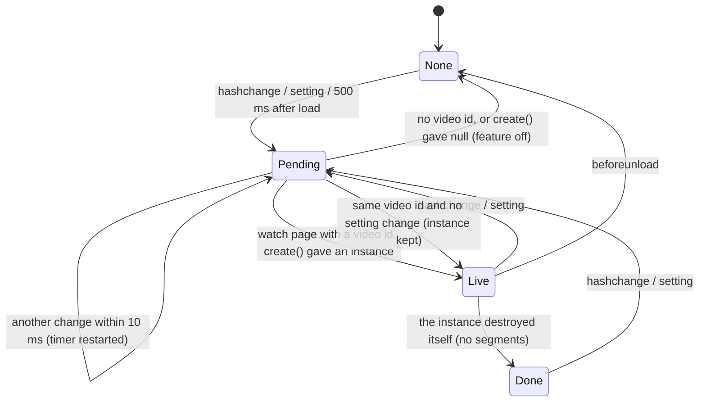
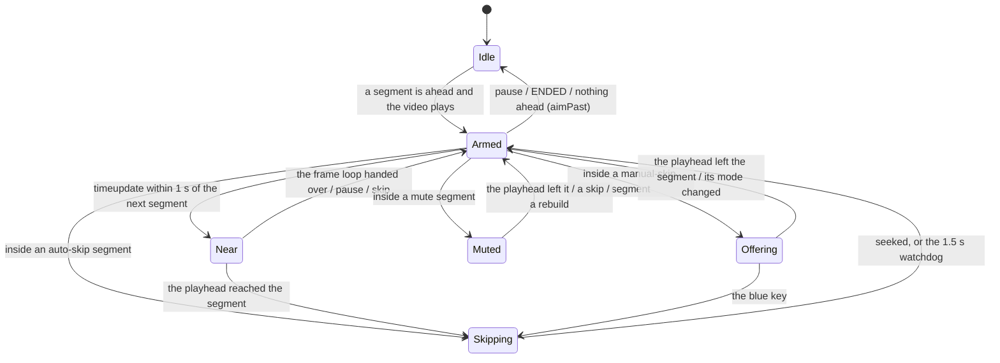
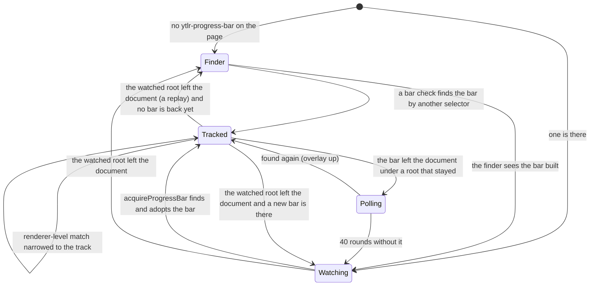

# State machines

The code has no state-machine library and no `state = 'X'` field for most of
what follows: a state is a combination of plain fields (a timer id, an
observer, a boolean) that the hot paths read directly. This page names those
states, says which fields hold them, what moves between them and what must
always be true, so a change can be checked against the machine instead of
being rediscovered from the code. Kept by hand, like
[ARCHITECTURE.md](ARCHITECTURE.md); the functions are in
[CODEMAP.md](CODEMAP.md).

- **Rules that run.** The rules of the SponsorBlock handler are code:
  `tests/harness/invariants.cjs` checks them after every event every
  SponsorBlock behaviour test sends, and the script fails when one breaks at
  any step. A rule added there is enforced across some 270 test steps at once.
- **Why the states stay plain fields.** The readers are the hot paths (the
  time listener at 4 Hz, the frame loop, focus and key listeners), on an
  engine (V8 3.28, webOS 3) where a property read is cheap and an extra call
  or object is not. The fields are what the behaviour tests pin. Naming the
  states here and checking the rules in the tests gives the safety of an
  explicit machine without a byte or a call in the bundle.
- **When changing one.** Find the machine below, keep its rules, and when a
  new field can disagree with an old one, add the rule to
  `tests/harness/invariants.cjs` (SponsorBlock) or a test of the transition.

## Index

| Machine | Where | Driven by |
| --- | --- | --- |
| [Page kind](#page-kind) | `core/page-state.js` | `<body>` class changes |
| [Per-video instance](#per-video-instance) | `core/per-video.js` | `hashchange`, the feature's setting, unload |
| [SponsorBlock: lifecycle](#sponsorblock-lifecycle) | `features/sponsorblock/index.js`, `api.js` | the segment fetch, destroy |
| [SponsorBlock: the `<video>`](#sponsorblock-the-video) | `index.js`, `bar.js` | mount, replacement, PLAYING |
| [SponsorBlock: playback](#sponsorblock-playback) | `skipping.js`, `chain.js`, `blue-key.js`, `mute.js`, `video-events.js` | `timeupdate`, frames, `seeked`, player state, settings |
| [SponsorBlock: the progress bar](#sponsorblock-the-progress-bar) | `bar.js`, `overlay.js` | DOM mutations, frames, a bounded poll |
| [Return YouTube Dislike](#return-youtube-dislike) | `features/return-dislike/` | focus, the description panel, the dislike fetch |
| [Force Max Quality](#force-max-quality) | `features/video-quality/` | page changes, the player's `onStateChange` |
| [Screensaver fix](#screensaver-fix) | `features/screensaver-fix/` | page changes, `<video>` style mutations, `pause`/`playing` |
| [Max Thumbnail Quality](#max-thumbnail-quality) | `features/thumbnail-quality/` | parsed responses, probes, arrow keys |
| [DeArrow](#dearrow) | `features/dearrow/` | parsed responses, branding lookups, settings |
| [Options panel](#options-panel) | `ui/panel/` | the menu key, keys and pointer while open |
| [Shortcuts](#shortcuts) | `ui/shortcuts/` | `keydown` |
| [Toasts](#toasts) | `ui/toast/index.js` | `showNotification`, timers |
| [Smaller ones](#smaller-ones) | several | see the table |

## Page kind

`core/page-state.js`. Four booleans (`onWatchPage`, `onShortsPage`,
`onAccountSelectorPage`, `onSearchPage`) mirror four `<body>` classes. A
MutationObserver on the body's `class` reads them on every change and
dispatches `ytaf-page-update` only when one of the four changed.

- The event's `detail` carries `isWatch`, `isShorts` and `isAccountSelector`;
  a change of the search page fires the event too, without a field of its own
  (`isSearchPage()` reads it).
- A watch-to-watch navigation changes no class: no event. Whatever must
  follow a new video listens to `hashchange` (per-video instances, the
  screensaver fix) or to the player state.

## Per-video instance

`core/per-video.js`, used by SponsorBlock (`window.sponsorblock`) and Return
YouTube Dislike (`window.returnYouTubeDislike`).

| State | Fields |
| --- | --- |
| None | `current === null` |
| Pending | `timer !== null`; `restartPending` remembers a setting change across restarts of the timer |
| Live | `current` set, `!current.isDestroyed`; the getter returns it |
| Done | `current` set, `current.isDestroyed`; the getter returns null |

- **Done is kept on purpose**: the same video under a new hash does not
  create a new instance, so "no segments for this video" is asked once.
  It also means a fetch that failed on every retry is final for that video
  until the hash names another one or the setting is toggled.
- An instance must offer `init()`, `destroy()` (safe to call twice),
  `videoID` and `isDestroyed`.

## SponsorBlock: lifecycle

`SponsorBlockHandler` in `features/sponsorblock/index.js`.

| State | Fields | Next |
| --- | --- | --- |
| Created | `segments = []`, config listeners in `bag` | `init()` |
| Fetching | `abortFetch` set while a request is in flight; between retries a timer in `bag` | segments, none, or destroy |
| Labels only | `segments` hold full-video labels only: no `<video>`, no bar, no window listeners | destroy |
| Active | window listeners bound, `<video>` bound or waited for, bar watched | destroy |
| Destroyed | `isDestroyed`; every handle below is gone | (end) |

- The API is asked on the primary server, then the fallback, then again after
  2 s and 4 s (`API.retryMs`). An empty list or no list at all destroys the
  handler; see Done above.
- `destroy()` rules (checked): no `<video>` bound, no frame pending
  (`rafIds` empty), no observer, no wait, no watchdog, no prompt, no mute
  held, no overlay, no segments.

## SponsorBlock: the `<video>`

| State | Fields | Moves on |
| --- | --- | --- |
| Unbound | `video === null`, `videoBag === null`, `videoWait === null` | `bindOrWaitForVideo()` |
| Waiting | `videoWait` set (a MutationObserver on the body, 10 s) | a `<video>` mounts; the wait runs out (then the next PLAYING looks again) |
| Bound | `video` and `videoBag` set | the element leaves the document (noticed by a bar check: `rebindIfVideoReplaced`), destroy |

Rules (checked): `video` and `videoBag` are set together; the time listener,
the frame loop, a held mute and the metadata wait (`chainRetry`) exist only
with a bound `<video>`; no wait runs while one is bound. `highlightPending`
holds the highlight's auto jump until a `<video>` is bound.

## SponsorBlock: playback

The richest machine: where the playhead is relative to the skip list, and
what is running because of it. `skipSegments` is rebuilt from `segments` and
the settings (`refreshSkipSegments`); every other field refers to it.

| State | Fields |
| --- | --- |
| Idle | `timeListenerActive === false`, `pollingRafId === null` |
| Armed | `timeListenerActive`; `nextSegmentIndex`, `nextSegmentStart` aim at the segment the playhead is in or the next one |
| Near | Armed and `pollingRafId` set: `highFreqLoop` reads `currentTime` every frame |
| Skipping | `isSkipping` and `skipWatchdogTimer` set; `handleTimeUpdate` and the frame loop return at once |
| Offering | `currentManualSegment` (a segment of `skipSegments`) and `activeManualNotification` (its toast) |
| Muted | `mutedSegment` (a segment of `skipSegments`), `mutedBefore` (what to restore) |

Other fields: `lastSkipTime` and `lastSkippedSegmentIndex` (the same skip
reported twice is one skip; on webOS 3 to 6 the clamped end segment is not
skipped again), `skippedSegmentIndices` (Skip Segments Once),
`tempWhitelistIndex` (the segment the "previous segment" shortcut seeked back
into: left alone until the playhead leaves it).

Events, and what each does:

| Event | Effect |
| --- | --- |
| `timeupdate` (while Armed) | `handleTimeUpdate`: leaves a prompt or mute the playhead left, starts the frame loop within 1 s of the next segment, and inside a segment skips, mutes or offers by its mode |
| a frame (while Near) | hands over to `handleTimeUpdate` once the playhead is there; stops on pause, a skip or destroy |
| `seeked` with `isSkipping` | the handler's own skip landed: latch and watchdog cleared, nothing else (the skip aimed past its landing point already) |
| `seeked` without | the viewer's seek: dedupe fields reset, `resetSegmentTracking`, the start chain, and `handleTimeUpdate` when playing |
| `playing`, player state PLAYING | `resetSegmentTracking` (both, since a player may report only one); PLAYING also re-finds the bar and runs the start chain |
| `pause`, player state PAUSED | frame loop stopped, time listener detached |
| player state ENDED | time listener detached; the overlay's cached hash, anchor and geometry dropped so a replay redraws |
| `durationchange` | segments clamped to the duration; when one moved, `refreshSkipSegments` |
| a mode setting, Allow muted segments | `refreshSkipSegments`, overlay redrawn, labels rewritten |

Rules (checked after every event):

- `nextSegmentIndex` is in `0..skipSegments.length`, and `nextSegmentStart`
  is that segment's start, or `Infinity` past the last one.
- The time listener runs only while a segment is ahead
  (`nextSegmentStart !== Infinity`).
- `isSkipping` implies an armed watchdog: a skip whose `seeked` never comes
  is released after 1.5 s.
- A prompt on screen offers a segment, and the segment offered is a
  `manual_skip` member of the **current** `skipSegments`. `refreshSkipSegments`
  carries the offer into the rebuilt list (`carryManualSegment`) or drops it.
- The muted segment is a `mute` member of the current `skipSegments`.
- `tempWhitelistIndex` is `-1` or an index into `segments`.

Known edge, left as it is: a viewer's seek that starts while one of the
handler's own skips is still seeking produces one `seeked` for both. It is
taken for the skip's (the latch is cleared, tracking is not re-aimed), and
the next `playing` or PLAYING re-aims. Telling the two apart by the landing
time would need the engine's seek rounding on real TVs.

## SponsorBlock: the progress bar

`bar.js` finds the bar, `overlay.js` draws beside it.

| State | Fields |
| --- | --- |
| Finder | `finderObserver` set (subtree observer on the app root); `domObserver`, `attrObserver`, `progressBar` all null |
| Watching | `domObserver` and `attrObserver` set, `observedRoot` connected, `progressBar === null` |
| Tracked | `progressBar` set; `barSelectorIndex` says which selector matched (`>= 2`: above the track, narrowed once the track exists); `anchor` caches the element the overlay sits beside |
| Polling | `barRetry.active`: `acquireProgressBar` every 250 ms, at most 40 times |

- A bar check is one frame at a time: `isProcessing` is the "a check is
  already scheduled" bit, `barChecks` counts the requests (read it on the TV:
  hundreds in ten seconds mean a selector matches an element YouTube changes
  every frame).
- Rules (checked): the finder never exists beside the bar observers or a
  tracked bar; the two bar observers come as a pair; the poll never runs
  beside the finder; a cached `anchor` belongs to the tracked bar; the
  overlay has one mark (`overlayMarks`) per child.
- Overlay: `lastOverlayHash` (duration, modes, segment count) says what is
  drawn; `lastSyncSig` (`h` or `v`, then the box) says where. A hidden bar
  already synced as hidden costs no layout read.

## Return YouTube Dislike

One `ReturnYouTubeDislike` per video (`features/return-dislike/`), alive even
with the count off: the description panel's keyboard navigation is its too.

| Sub-machine | States | Fields |
| --- | --- | --- |
| The count | unknown, fetching, known, retrying (3 times, 1.2 s more each), gave up | `dislikesValue` (null: unknown, never cached), `abortFetch`, `fetchAttempts`, the `retry` timer |
| The panel | none, tracked, stale | `panelElement`, `panelBag` (its two observers), `panelPoll` (bounded: 20 rounds of 500 ms, armed by the description shortcut and by a stale panel) |
| The factoid | absent, placeholder, number | `dislikeFactoidElement`, `dislikeValueElement`, `factoidContainer`, `cachedMode` (the panel's layout) |
| Focus | outside, inside | `isPanelFocused`, `lastFocusedElement`, `focusedIndex`, `menuItemsCache` and `menuItemsMap` (dropped on any panel mutation that is not the instance's own) |
| Header shift | none, shifted by n px | `shiftedList`, `shiftMemo`, `shiftStyle` |

- `isProgrammaticFocus` is true only inside `moveFocus()`'s own `focus()`
  call, so the focus listeners ignore it.
- Named timers (`schedule(fn, ms, name)`): scheduling a name again replaces
  the pending one; `destroy()` clears all. Names in use: `retry`, `inject`,
  `focusSettle`, `highlightClear`.
- `releasePanel()` is the one way out of "tracked": it clears every field
  that points into the panel. A new field pointing into the panel is reset
  there.

## Force Max Quality

`features/video-quality/`, all on the `vq` object (`state.js`).

| State | Fields |
| --- | --- |
| Detached | `bag === null`, `navTimer === null` |
| Attach scheduled | `navTimer` set (a tick after the watch page appears) |
| Looking for the player | `bag` set, `poll` set: every 200 ms 50 times, then every 1 s 50 times, then it stops |
| Attached | `bag` set, `player` set; `handleStateChange` receives the player's states |

Attached, per video: `lastVideoId`, `qualitySetForVideo` (videos already
settled), `videoBeingProcessed` (an intercept in flight: pause, force,
resume over two frames). webOS 25 only: `kickstartInProgress`,
`hasKickstarted` (once per session, survives a detach) and `kickstartRun`
(bumped by every detach, so a kick loop of a previous attach stops).

- `handleStateChange` publishes `yt-player-state-change` first, whatever the
  setting: the clock, SponsorBlock and the playback speed's quality cap
  follow the player through it. It exists only while Attached, so it is
  silent off the watch page (the Shorts keep-alive asks the player itself).
- `isForceEnabled()` is the one answer to "is quality forced now": the
  setting, not an inline preview, not capped by the playback speed
  (`core/speed-cap.js`).

## Screensaver fix

- **Page and `<video>`** (`index.js`): `lastPageType` (`WATCH`, `SHORTS`,
  `OTHER`), `currentVideoElement` (observed for `style` changes),
  `videoWait` (the wait for a `<video>` on the watch page, cancelled on a
  page change). `rafPending` and `rafTargetVideo` coalesce a burst of style
  mutations into one check per frame.
- **Shorts keep-alive** (`shorts-keep-alive.js`): off, or on with a 30 s
  interval (`shortsKeepAliveTimer`) and, for 250 ms after each press, the
  second half of the key burst (`shortsBufferTimer`).
- **Decoder stall** (`decoder-stall.js`): per `<video>`, `pausedAt` (a
  WeakMap) remembers when it was paused; a `playing` more than 30 s later
  arms one check (`pending`) 2 s ahead, which seeks in place when the clock
  has not moved. `pause` or another `playing` cancels it; the nudge's own
  `playing` finds no `pausedAt` and is not checked again.

## Max Thumbnail Quality

`features/thumbnail-quality/`, shared state in `state.js`.

Per video:

| State | Held in |
| --- | --- |
| Unknown | in none of the collections |
| Queued | `probeQueue` and `probeAttempted` (one attempt per session; `queuedByParse` then `latestParse` say which parse queued it) |
| Probing | counted in `state.activeProbes` (at most 3) |
| Verified | `qualityCache` (videoId to rank; saved to localStorage, debounced) |
| Unconfirmed | `qualityCache` and `unconfirmed`: a probe that learned nothing in Original mode; the floor for this session, not saved |
| Awaiting correction | `pendingEntries` (the response objects written to), `provenFloor`, then `pendingPromotions` and `promotionAttempts` for tiles already on screen |

The scheduler (`probes.js`):

| Gate | Fields | Effect |
| --- | --- | --- |
| Idle | `state.lastParseAt`, `PROBE_IDLE_DELAY` (1.2 s) | probes wait until responses stop arriving (a scroll), except the two bursts below |
| Urgent burst | `urgentLeft` (4 per parse), `latestParse` | the first videos of the latest response go at once |
| Visible burst | `state.visibleBudget` (6), `state.visibleSample` (reused for 250 ms) | tiles on screen go at once |
| Arrow keys | `state.lastNavAt`, `NAV_PAUSE_MS` (350 ms) | no probe and no promotion while the remote moves |
| Background | `document.hidden` | nothing runs; pending promotions are dropped |

- `state.probeTimer` (a delayed drain), `state.probePump` (an idle
  callback), `state.promoteTimer` (a sweep) and `state.saveTimer` are each
  "at most one pending".
- `state.probeGeneration` is bumped when the mode's rung changes
  (`resetVerification`): a probe that started before carries the old number
  and its answer is dropped.
- The stored cache is valid only for the rung and revision in
  `ytaf-thumb-quality-cap`; anything else drops it.

## DeArrow

`features/dearrow/`. Off by default.

Per video (`videos`, a Map of videoId to record):

| State | Fields |
| --- | --- |
| New | record created by `patchResponseTiles`, id queued for a lookup |
| Fetching | `fetching` (the branding request's promise, shared) |
| Fetched | `fetched`, `raw` (the answer, or null) |
| Resolved | `resolved`; `title`, `thumb` (null: YouTube's own), `crowdTitle`, `crowdThumb` |
| Shown | `shownTitle`, `shownThumb` (what the sweep last wrote, so it can be put back) |

- `tiles` are the response objects of the video (the last 8), written to
  when it resolves; `originals` (a WeakMap) is what each had.
- `generation` (`state.js`) is bumped by every settings change and wipe: an
  answer that lands for an older generation is dropped.
- The lookup pump: `queue`, `active` (at most 4). The sweep: `sweepTimer`
  (at most one pending, 300 ms after a parse, a lookup or a key press).
- A wipe (1000 videos, or the thumbnail copies' memory budget) puts every
  original back, then forgets everything.
- The walk of a response is skipped when its JSON text holds no
  `"tileRenderer"` key (`window.__ytafDeArrowStats` counts both).

## Options panel

`ui/panel/panel.js`.

| State | Fields |
| --- | --- |
| Not built | `panel === null` |
| Opening block | `panelInitBlock` for 500 ms after the first build: toggles are ignored (a held menu key delivered after the build's freeze would close it again) |
| Hidden | `panel` set, `optionsPanelVisible === false` |
| Visible | `optionsPanelVisible`; the keyboard handler and the focus trap are attached |

- Pages: only Main is built with the panel; the others are built one per
  frame afterwards (`createDeferredBuilder`), or at once when their tab is
  picked first. A builder never runs twice.
- Keyboard while visible (`keyboard.js`): `pointerActive` (a Magic Remote
  pointer is in use: Enter leaves the click to the pointer), `enterHeldSince`
  and `dropClicksUntil` (the pointer click that follows an Enter is dropped),
  `ownClick` (the handler's own click passes).
- Closing with Back or Escape swallows that key until it is released
  (`swallowUntilReleased`, 2 s at most).
- The SponsorBlock popup (`features/sponsorblock/popup.js`): `visible` is
  what the panel asks for, `hasSegments` what the video has; it shows only
  with both. `rowsStale` defers building the rows until it is shown.

## Shortcuts

`ui/shortcuts/`.

- **Router debounce** (`bindings.js` `shortcutState`): `lastKey`,
  `lastTime`, `debounceMs` (100 ms; 650 ms for a moment after a pause, so
  the controls dismissal is not interrupted). A repeat is swallowed, never
  passed to YouTube. Burst actions (the seeks) are exempt.
- **Burst seek** (`seek.js`): `seekAccumulator` (the total in the toast,
  reset 1.2 s after the last press or when the direction flips),
  `pendingSeekOffset` (not applied yet; applied 200 ms after the last press).
- **Chapter skip**: `skipInFlight` (one at a time), `chaptersForcedFor` (the
  video whose player UI was already forced open once to read the markers).
- **Play/pause**: after a pause the controls bar is hidden for 750 ms
  (`ui/hide-controls.js`: `saved` holds the shadows' own opacity while
  hidden, `timer` the end of the window).
- **OLED overlay** (`oled.js`): on while the overlay element exists;
  `keepAliveTimer` presses UP every 30 minutes.

## Toasts

`ui/toast/index.js`. A toast is hidden for its first two frames, shown, then
`fading` for 1 s, then removed. `liveToasts` (by text: a repeat extends the
toast) and `slotToasts` (by slot: the play/pause state and the seek total
change one toast in place) let go of a toast the moment it starts fading.

## Smaller ones

| Machine | Where | States and fields |
| --- | --- | --- |
| Settings write | `core/config.js` | clean, or dirty with `pendingWriteTimer` (200 ms debounce; flushed on `beforeunload` and `pagehide`) |
| `<video>` cache | `core/dom.js` | `cachedVideo`, dropped when the page is neither watch nor Shorts or the element leaves the document |
| Tracking Block | `features/adblock/tracking-block.js` | `active` follows the flag; `xhrInstalled` goes true once and stays (the wrappers are never removed, only gated) |
| Fetch hook | `hooks/fetch.ts` | `registry` null until first use; with no listener and diagnostics off, every fetch takes the unwrapped path |
| resolveCommand hook | `hooks/resolve-command.ts` | none, `pending` (one shared poll, 30 s), `registry`; a timed-out poll is retried by the next caller |
| Account-selector bypass | `features/auto-login/whos-watching.js` | `bypassUntil`: open for 15 s after start or a relaunch, closed (0) by the first bypass |
| Comments fix | `features/comments-fix.js` | startup scans every second until the rules are found (`foundRules`) or the stylesheet count held still for two scans; then up to 3 scans on panel focus (`scans`) |
| Clock | `features/watch/index.js` | no instance, or one per mode; shown or hidden by a class; `observedPlayer` is the player whose focus attribute is watched |
| Force Video Codec | `features/force-codec/` | `fc.mode` (`auto` when off, unknown or unsupported on this TV), `fc.installed` (hooks go in once), `fc.unsatisfiable` |
| Playback Speed | `features/playback-speed/` | `controller` null until the setting is first on; `currentSpeed`; `pending` (a reload 800 ms after the last change, remembering the speed and position the burst started from); one audio sink at a time |
| Buffer limit | `hooks/buffer-limit.js` | per SourceBuffer `__ytafTrimming` while a trim's `remove()` runs (an append then waits for `updateend`); `appendPatched` once |
| Legacy emoji fix | `features/emoji-font/observer.js` | `isObserving`; `emojiState.frameId` (one frame pending for the queued text nodes) |
| Emoji and filter flags | `features/adblock/flags.js` | one snapshot (`cfgFlags`, `cfgFlagsNoEmoji`, `filterState`) recomputed on a setting change, never per parse |
